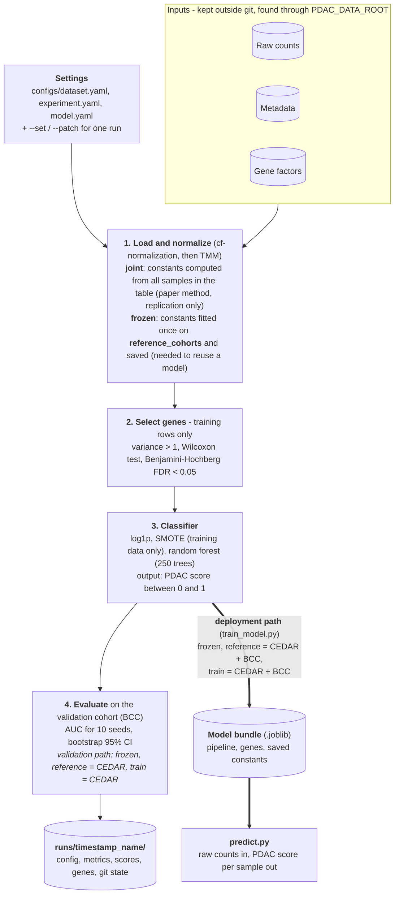

# pdac-cfrna-classifier

A from-scratch, tested Python replication of the plasma cell-free RNA (cfRNA) classifier for
pancreatic cancer (PDAC) from Moore et al., *Nature Communications* 16:7345 (2025),
[doi:10.1038/s41467-025-62685-y](https://doi.org/10.1038/s41467-025-62685-y).

Raw gene counts go in. A PDAC score between 0 and 1 for each sample comes out. Every step of the
paper's pipeline (normalization, gene selection, classifier) is implemented here, configurable from
three small YAML files, and recorded in a reproducible run folder.

> **Status: research code, not a diagnostic tool.** It has been validated on one external cohort
> of 95 samples (21 with PDAC). See [Limitations](#limitations).

## The pipeline



More detail, including how the code is organised, is in [`docs/architecture.md`](docs/architecture.md).

## Results

Trained on the CEDAR cohort (153 samples, 20 PDAC), tested on the BCC cohort (95 samples, 21 PDAC).
AUC over 10 random seeds (mean ± sample standard deviation).

| Task | Paper (BCC) | This repo, joint normalization | This repo, frozen normalization |
|---|---|---|---|
| PDAC vs benign | 0.904 | 0.927 ± 0.007 | 0.925 ± 0.010 |
| PDAC vs non-cancer | 0.937 | 0.932 ± 0.008 | 0.922 ± 0.007 |
| PDAC vs all | 0.896 | 0.891 ± 0.011 | 0.889 ± 0.008 |

- **Joint** normalization is what the paper does. **Frozen** fits the normalization constants on
  CEDAR only and applies them to each sample alone, so a score does not depend on which other
  samples are in the file. That is the mode a deployed model needs.
- The ± is seed-to-seed variation. With only 21 PDAC cases in the test cohort, the uncertainty from
  the test set itself is much larger, about ±0.06 on the AUC (bootstrap 95% interval).
- Gene selection finds 29 genes with joint normalization and 36 with frozen normalization. All 24
  genes the paper names are recovered.
- Letting SMOTE balance the classes exactly instead of adding 100 synthetic samples changes the AUC
  by less than 0.005 (the paper's description is ambiguous here, so both are supported).

The full table for your own runs is produced by `scripts/summarize_runs.py`.

## Quickstart

Requirements: Python 3.11+ and [uv](https://docs.astral.sh/uv/). The clinical data is not in this
repo; you need the four input files listed under [Data](#data).

```bash
uv sync
copy .env.example .env        # then set PDAC_DATA_ROOT to the folder that holds the data files
uv run pytest -m "not slow"   # fast tests, no data needed
uv run pytest -m slow         # real-data tests, a few minutes
```

Reproduce the paper's PDAC-vs-all result (defaults are the paper setup):

```bash
uv run python scripts/run_paper_replication.py --name paper_pdac_vs_all
```

Other tasks, SMOTE balancing and frozen normalization are one `--set` away:

```bash
uv run python scripts/run_paper_replication.py --name paper_pdac_vs_benign --set experiment.task=pdac_vs_benign

uv run python scripts/run_paper_replication.py --name balanced_pdac_vs_all --set experiment.n_synthetic_pdac=null

uv run python scripts/run_paper_replication.py --name frozen_pdac_vs_all --set dataset.normalization.mode=frozen --set "dataset.normalization.reference_cohorts=[CEDAR]"

uv run python scripts/summarize_runs.py --out reports/results_table.md
```

On Windows PowerShell and cmd.exe use double quotes around values containing `[ ]`. All the
settings and more recipes are in [`docs/configuration.md`](docs/configuration.md).

### Train a model and score new samples

```bash
uv run python scripts/train_model.py --name model_frozen_pdac_vs_all --set dataset.normalization.mode=frozen --set "dataset.normalization.reference_cohorts=[CEDAR]"

uv run python scripts/predict.py --model runs/<run_folder>/model.joblib --counts new_counts.csv --out scores.csv
```

`new_counts.csv` holds raw counts with genes in rows and samples in columns. Each sample is
normalized on its own with the constants saved in the model, then scored. Model files are pickles:
only load files you made or trust.

## Design

- **One config file per kind.** `configs/dataset.yaml`, `configs/experiment.yaml` and
  `configs/model.yaml` hold the defaults (the paper replication). A run changes only what it needs
  with `--set section.key=value` or a small `--patch` file. Unknown keys, wrong types and invalid
  combinations stop the run before anything is written.
- **Reproducible runs.** Every run writes `resolved_config.yaml` (usable as a `--patch` to repeat
  it), the git commit and uncommitted changes, library versions, seeds and metrics to
  `runs/<timestamp>_<name>/`.
- **No leakage by construction.** Gene selection uses only the training cohort. SMOTE runs inside
  the training pipeline and never touches validation samples.
- **No data in git.** Clinical data lives outside the repo; `PDAC_DATA_ROOT` points to it.
- **Tested.** Hundreds of unit tests, plus slow golden tests that pin the replication numbers on
  the real data.

## Layout

```
configs/        dataset.yaml, experiment.yaml, model.yaml (the defaults)
src/pdac_cfrna/ the library (see docs/architecture.md)
scripts/        command-line entry points
tests/          unit tests (synthetic data) and slow golden tests (real data)
docs/           configuration, architecture, pipeline report, data notes
reports/        curated results tables and figures
runs/           per-run outputs (gitignored)
```

## Data

The default config expects these files in the folder named by `PDAC_DATA_ROOT`:

| File | Content |
|---|---|
| `pdac_genecount.csv` | raw counts, genes in rows, 248 samples in columns |
| `pdac_meta.csv` | one row per sample: `SeqID`, `Cohort` (CEDAR or BCC), `Pancreatitis_type` (the diagnosis) |
| `updated_intrinsic.csv` | per-gene intrinsic / extrinsic factors used by cf-normalization |
| `normalized_pdac_genecount.csv` | optional: the authors' normalized matrix, for cross-checks |

See [`docs/data_notes.md`](docs/data_notes.md) for quirks of each file.

## Limitations

- **One external validation cohort.** 95 samples, 21 with PDAC. Differences of a few hundredths in
  AUC between settings are within the noise.
- **Case-enriched cohorts.** The positive predictive value of a screening test depends on how rare
  the disease is. The AUC here says nothing about that.
- **A score, not a test.** There is no calibrated probability and no chosen decision threshold.
- **Not clinically validated.** No other populations, sample-collection sites, or sequencing
  batches have been tested.
- **The paper's own cross-validation chooses genes before splitting the data**, which inflates
  its cross-validated numbers. This repo selects genes on the training cohort only.

See [`docs/pipeline_report.md`](docs/pipeline_report.md) for the full discussion.

## Citation

Moore, T. W. et al. Cell free RNA detection of pancreatic cancer in pre diagnostic high risk and
symptomatic patients. *Nat Commun* 16, 7345 (2025).
Original code: <https://github.com/ohsu-cedar-comp-hub/2024_ngolab_cfRNA>

## License

See [`LICENSE`](LICENSE).
