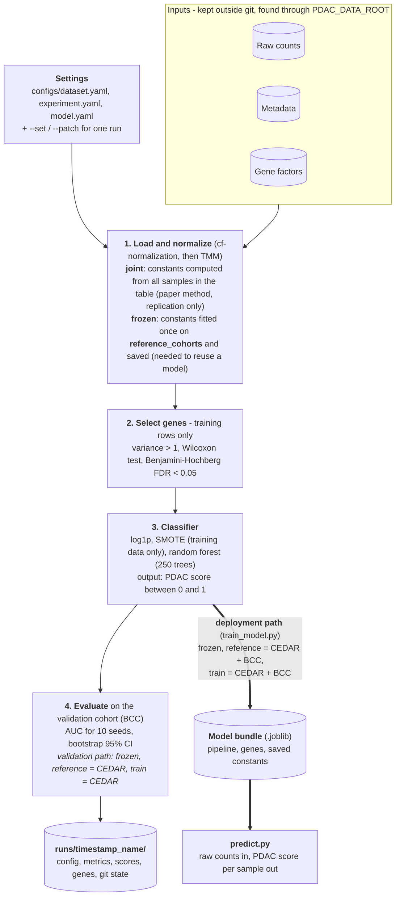
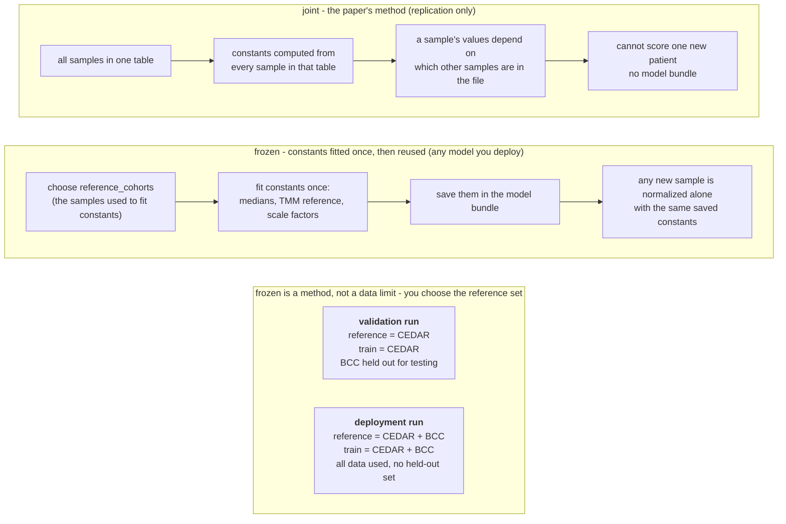

# Architecture

## End-to-end flow

## The four stages

### 1. Load and normalize (`data.py`, `normalization.py`)

1. Read the raw count matrix (genes x samples) and the metadata.
2. **cf-normalization** splits each gene's counts into an intrinsic part (from the blood cells)
   and an extrinsic part (from other tissues) using per-gene factors, then rescales each sample
   by the median of its intrinsic signal. **TMM** then corrects for differences in library
   composition between samples.
3. The experiment's **task** (PDAC vs benign, vs non-cancer, or vs all) turns the diagnosis column
   into 0/1 labels and drops samples that do not belong to the task.
4. The **split** marks which cohort is training (CEDAR) and which is validation (BCC).

Normalization happens before any samples are dropped, so it sees all the samples in the file, as in
the paper.

### 2. Select genes (`selection.py`)

Applied to the training cohort only, using the gene-selection task's labels (PDAC vs all):

1. **Variance filter:** keep genes whose sample variance is above 1.
2. **Wilcoxon rank-sum test** for each remaining gene, PDAC vs the rest.
3. **Benjamini-Hochberg** correction; keep genes with an adjusted p-value below 0.05.

The same gene list is used for every task.

### 3. Classifier (`models.py`)

An `imblearn` pipeline of three steps:

1. `log1p` transform.
2. **SMOTE** creates synthetic PDAC training samples. It is applied only while fitting; it never
   touches validation samples. By default it adds 100 synthetic samples (`n_synthetic_pdac: 100`).
   With `n_synthetic_pdac: null` it balances the classes exactly.
3. **Random forest**, 250 trees, `max_features=1`, `min_samples_leaf=1`, bootstrap on.

### 4. Evaluate and record (`evaluation.py`, `runs.py`, `reporting.py`)

The pipeline is trained once per seed (10 seeds by default). The run reports the AUC per seed and
its mean and sample standard deviation, plus the AUC of the seed-averaged score with a bootstrap
95% confidence interval. The interval is the number to quote, because it reflects how few patients
the validation cohort has. Everything is written to the run folder.

## Normalization modes: what "joint" and "frozen" mean

Normalization (cf-normalization, then TMM) needs constants: medians, a TMM reference and
scale factors. The two modes differ only in where those constants come from.

| | joint | frozen |
| --- | --- | --- |
| Constants come from | every sample in the table, recomputed each time | the `reference_cohorts` you choose, fitted once and saved |
| A sample's normalized values depend on | which other samples are in the table | nothing but the sample itself and the saved constants |
| Can score one new patient | no | yes |
| Can be saved as a model bundle | no, `train_model.py` stops with an error | yes |
| Used for | replicating the paper's numbers | validation runs and the deployed model |

"Frozen" does **not** mean "only the training cohort" or "less data". It means the constants
are fitted once and then kept unchanged. You decide which samples go into that fit.

### The three ways we run it

| Run | normalization | reference_cohorts | trained on | validated on | Purpose |
| --- | --- | --- | --- | --- | --- |
| Paper replication | joint | not used | CEDAR | BCC | match the paper's AUCs |
| Honest validation | frozen | CEDAR | CEDAR | BCC | measure how the workflow performs on unseen data |
| Deployment model | frozen | CEDAR + BCC | CEDAR + BCC | none | use all available data in the model that gets deployed |

The deployment model has no held-out set, so its performance is taken from the validation run.
Its gene list can differ a lot from the validation model (872 genes versus 36 in our runs), so
that selection rule must be settled before the model is called deployable.

## Code map

| Module | Responsibility |
|---|---|
| `config.py` | Dataset settings (files, normalization, labels, split) as validated models |
| `experiment.py` | Experiment settings and the three tasks |
| `model_config.py` | Random-forest settings |
| `run_config.py` | Merges the three default YAMLs with `--patch` / `--set` into one `RunConfig` |
| `data.py` | Loads, normalizes, labels and splits a dataset |
| `normalization.py` | cf-normalization, TMM, CPM, and the frozen normalizer |
| `nmf.py` | Constrained NMF that learns the intrinsic / extrinsic gene factors |
| `selection.py` | Variance filter, Wilcoxon test, Benjamini-Hochberg correction |
| `models.py` | The log1p, SMOTE and random-forest pipeline |
| `evaluation.py` | AUC and bootstrap confidence interval |
| `training.py` | Gene selection for a run and model-bundle training |
| `bundle.py` | Saves and loads a model bundle with library-version checks |
| `predict.py` | Raw counts to PDAC scores using a bundle |
| `runs.py` | Run folders, run lock, git state and package versions |
| `reporting.py` | Builds the results table from run folders |

| Script | Purpose |
|---|---|
| `run_paper_replication.py` | Select genes, train, validate, record a run |
| `train_model.py` | Train and save a model bundle |
| `predict.py` | Score a raw count table with a bundle |
| `summarize_runs.py` | Markdown table of the newest run per experiment |
| `fit_reference_factors.py` | Learn the gene factors with NMF from a healthy reference set |
| `normalize_counts.py` | Normalize a raw count table to a CSV |
| `replicate_de_selection.py` | Gene selection only, with a comparison to the paper's named genes |
| `check_task_splits.py` | Check the sample counts of every task's split |

## Run folder contents

`runs/<timestamp>_<name>/` holds `resolved_config.yaml` (repeat the run with `--patch`),
`run_metadata.json` (status, results, git commit, package versions, overrides), `de_genes.csv`
(the gene-selection table), `test_scores.csv` (one score per validation sample and seed) and,
if the working tree had uncommitted changes, `code_changes.diff`. Runs are serialised with a file
lock so two runs cannot write at once.

## Design decisions

- **Config as data, merged once.** All three YAMLs are validated together, so an invalid
  combination fails before any run folder exists.
- **Leakage guarded by structure.** Selection takes only training rows; SMOTE lives inside the
  pipeline.
- **Deployment constraints are explicit.** Only frozen normalization can be saved into a bundle,
  and a bundle records the library versions it was trained with and refuses to load under a
  different scikit-learn or imbalanced-learn minor version.
