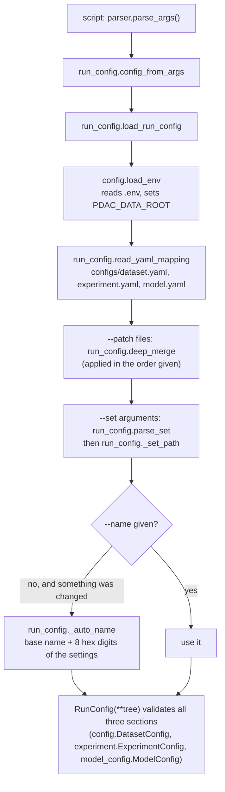
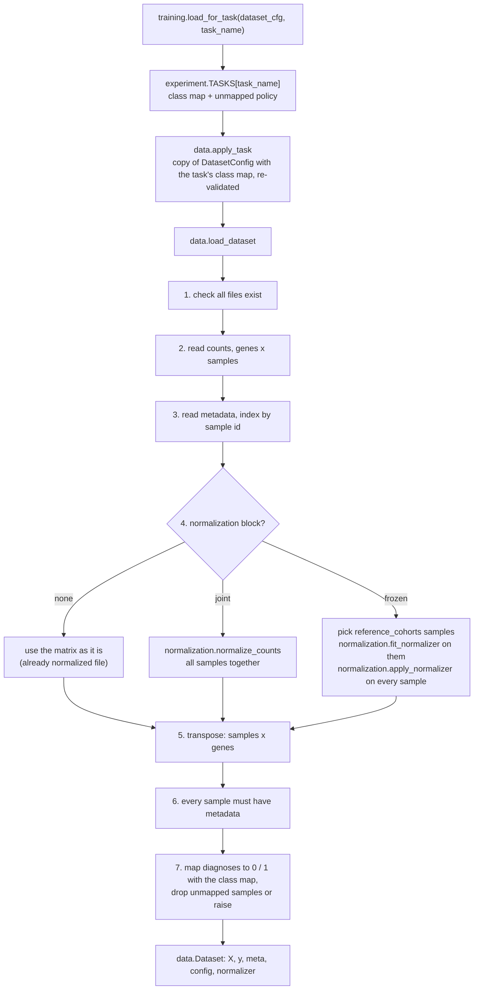
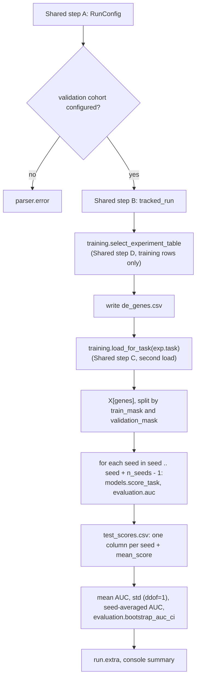
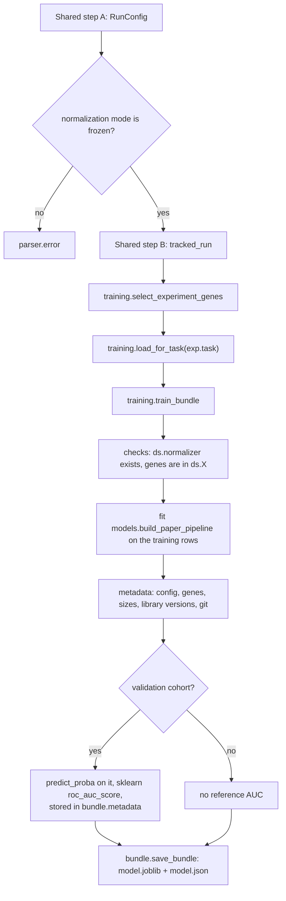
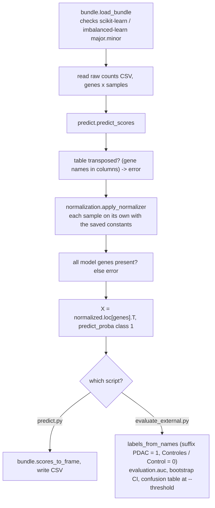
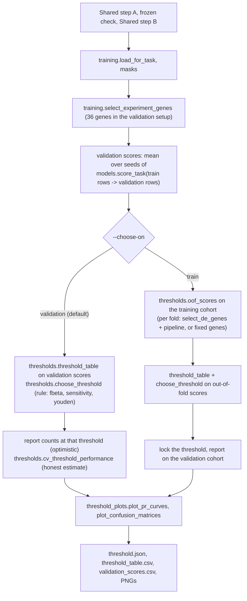

# Execution flows: what happens when you run each script

How to read this page: every box is a real function (`module.function`). The first four sections
are steps that many scripts share; each script section then lists its own steps and says which
shared steps it calls. Signatures and one-line descriptions of every function are in
[api_reference.md](api_reference.md). Where the code does something that looks odd or wasteful it
is marked **Note**.

## Shared step A: from the command line to one validated `RunConfig`

Used by every script that calls `run_config.add_config_arguments`: `run_paper_replication.py`,
`train_model.py`, `select_threshold.py`, `replicate_de_selection.py`, `check_task_splits.py`.

What each step does, in order:

1. `config.load_env` loads `.env` from the repo root. It never overrides a real environment
   variable. This is where `PDAC_DATA_ROOT` comes from.
2. `run_config.read_yaml_mapping` reads the three default YAMLs into one dict, one key per section
   (`dataset`, `experiment`, `model`).
3. Each `--patch FILE` is merged on top with `run_config.deep_merge` (mappings merge key by key,
   everything else replaces). A `resolved_config.yaml` from an old run works as a patch.
4. Each `--set a.b.c=value` goes through `run_config.parse_set` (the value is read as YAML, so
   `null`, `true`, `3`, `[CEDAR]` work; one pair of wrapping quotes is stripped for cmd.exe) and
   `run_config._set_path` writes it into the dict. An unknown path fails here.
5. If anything was changed and no name was given, `run_config._auto_name` makes
   `experiment.name = <base>-<hash of the settings>`: the same settings always get the same name.
6. `RunConfig(**tree)` runs pydantic validation. The models forbid unknown keys, so a typo fails
   before any data is loaded.
7. The `RunConfig.overrides` list keeps the text of every patch and set, which later shows up in
   `run_metadata.json` and in the results table.

## Shared step B: the run folder, `runs.tracked_run`

Every script that produces results wraps its work in `with tracked_run(cfg) as run:`.

1. `runs.run_lock` takes a file lock (`runs/.run.lock`), so two runs cannot start at the same
   moment.
2. `runs.create_run_dir` makes `runs/<timestamp>_<name>/`.
3. `run_config.dump_resolved` writes `resolved_config.yaml` (usable as a `--patch` to repeat the run).
4. `runs.git_info` records commit, branch and dirty state. If the working tree is dirty the diff
   is written to `code_changes.diff`.
5. `run_metadata.json` is written with `"status": "running"`, the overrides, the full config and
   package versions.
6. The script body runs. It puts results into `run.extra` (a dict).
7. On exit, the metadata is rewritten: status `success` or `failed` (with the error text), the
   finish time, the duration, and `results = run.extra`.

Because `run_metadata.json` is rewritten at the end even after an error, a crashed run is still
visible (status `failed`). `reporting.runs_table` and `gene_comparison.read_run_genes` both ignore
runs that are not `success`.

## Shared step C: loading a dataset, `training.load_for_task`

Points to remember:

* The normalization (step 4) sees **every** sample in the file, and happens **before** samples
  are dropped by the class map. So a task that drops samples still normalizes with them.
* In joint mode the constants come from all samples at once and are thrown away (no
  `normalizer` on the `Dataset`). In frozen mode the constants are fitted on the reference cohorts
  only and kept in `Dataset.normalizer`; this is what a model bundle needs.
* `Dataset.train_mask` and `Dataset.validation_mask` are boolean Series built from
  `dataset.split` and the cohort column of the metadata. Rows are never split into separate
  tables: the code always selects with `X[ds.train_mask]`.
* **Note:** every call to `training.load_for_task` re-reads the files and re-fits the normalization.
  `run_paper_replication.py`, `train_model.py` and `select_threshold.py` each call it twice (once
  inside the gene selection, once for the experiment task), so the normalization runs twice per
  run. It is correct but slow; caching the loaded dataset within a run is on the robustness list.

## Shared step D: gene selection and the classifier

**Gene selection** (`training.select_experiment_table`, then `training.select_experiment_genes`):

1. `training.load_for_task(cfg.dataset, exp.gene_selection_task)` (default `pdac_vs_all`).
2. Take the training rows only: `ds.X[ds.train_mask]`, `ds.y[ds.train_mask]`.
3. `selection.select_de_genes`: `selection.filter_variance` keeps genes with sample variance above
   the cutoff; `selection.wilcoxon_per_gene` gives a p-value, an AUC and a direction per gene;
   `selection.adjust_pvalues` applies Benjamini-Hochberg; a gene is `significant` when
   `q_value < alpha`. The table is sorted by q-value.
4. `training.select_experiment_genes` returns the names of the significant genes.

**Classifier** (`models.build_paper_pipeline`, used by `models.score_task` and
`training.train_bundle`): an imblearn `Pipeline` with three steps, `log` (`np.log1p`), `smote`
(adds `n_synthetic_pdac` synthetic PDAC samples, or balances the classes when it is `null`; only
active while fitting) and `rf` (random forest from `configs/model.yaml`). `models.score_task`
fits it and returns `predict_proba` for class 1 as a Series named `pdac_score`.

---

## `scripts/run_paper_replication.py`: replicate the paper

* Genes are chosen once, on the training cohort, with the gene-selection task's labels, and reused
  for every seed.
* The seeds change SMOTE and the forest only; the genes and data do not change.
* Two uncertainties are reported separately: spread over seeds (`std_auc`) and the small test set
  (bootstrap CI of the seed-averaged score).
* Needs: `configs/*.yaml`, counts, metadata and the factor file. Produces: `de_genes.csv`,
  `test_scores.csv`, `run_metadata.json` (results block).

## `scripts/train_model.py`: train a deployable bundle

* A bundle (`bundle.ModelBundle`) holds the fitted pipeline, the gene list, the frozen
  `normalization.NormalizationConstants` and a metadata dict. That is everything `scripts/predict.py`
  needs, which is why joint mode cannot produce one.
* `bundle.save_bundle` writes the joblib file and a readable JSON file next to it.

## `scripts/predict.py` and `scripts/evaluate_external.py`: score new raw counts

* Every sample is normalized on its own, so one sample is enough and the batch makes no
  difference.
* The counts must be **raw counts** with the genes the factor table needs. Already normalized or
  log-scale tables give meaningless scores.

## `scripts/select_threshold.py`: decision threshold and confusion matrix

* `thresholds.threshold_table` evaluates every threshold of the grid 0.01 to 0.99;
  `thresholds.choose_threshold` picks one by the rule (for ties it takes the middle of the plateau).
* In the default mode the threshold is tuned on the same validation samples it is reported on.
  `thresholds.cv_threshold_performance` repeats "choose on 4/5, test on 1/5" to show the honest
  performance. It is the default because `--choose-on train` fails with 20 PDAC samples in CEDAR:
  with genes re-selected in every fold the out-of-fold AUC is 0.60 (threshold 0.05, unusable);
  with the 36 genes fixed, the held-out labels leak into the gene choice, the out-of-fold AUC is
  0.97 (against 0.895 on BCC) and the threshold 0.35 does not transfer (BCC sensitivity 0.67).
* `thresholds.oof_scores` skips a fold that selects no gene (it records 0 for that fold).

## `scripts/compare_genes.py`: selected genes against the paper

1. `gene_comparison.load_paper_genes` reads `reference/paper_genes.yaml` (25 named genes,
   `reported_total` 29).
2. `gene_comparison.collect_runs` visits every folder in `runs/`; `gene_comparison.read_run_genes`
   returns a run's genes from `de_genes.csv` (the `significant` rows) or from `model.json`, and
   `None` for runs that failed or saved no genes (threshold runs are skipped this way).
3. For each run `gene_comparison.compare` splits the genes into matched, selected-but-not-named and
   named-but-not-selected; `gene_comparison.render_run_report` writes `gene_comparison.md` into the
   run folder.
4. `gene_comparison.latest_per_name` keeps the newest run of each experiment name and
   `gene_comparison.render_summary` writes `reports/gene_overlap.md` (genes stable across runs).

## `scripts/summarize_runs.py`

`reporting.runs_table` reads `run_metadata.json` of every run, keeps the newest successful run per
experiment that reports an AUC, and `reporting.to_markdown` prints the table.

## `scripts/replicate_de_selection.py` and `scripts/check_task_splits.py`

* `replicate_de_selection.py`: Shared steps A and B, then `training.load_for_task`, training rows,
  `selection.select_de_genes`, `de_genes.csv`, and a comparison with the paper's genes written
  inside the script (the `PAPER_UP`, `PAPER_DOWN`, `PAPER_OTHER` sets).
* `check_task_splits.py`: Shared step A only (no run folder). Selects the genes once, asserts there
  are 29 (so it only works with the default joint settings), then loads each task from
  `experiment.TASKS` and asserts the train / test sizes against the lab sheet (the `EXPECTED` dict).

## `scripts/normalize_counts.py` and `scripts/fit_reference_factors.py`

Standalone tools, not part of a run.

* `normalize_counts.py`: `normalization.load_factors` then `normalization.normalize_counts`
  (`normalization.cf_norm` followed by `normalization.tmm`), writes the normalized CSV.
* `fit_reference_factors.py`: `nmf.fit_reference_factors` learns intrinsic and extrinsic fractions
  per gene from healthy reference samples using the constrained `nmf.nmf`; with `--counts` it also
  calls `nmf.adjust_factors` to extend the factors to the genes of a patient dataset.
